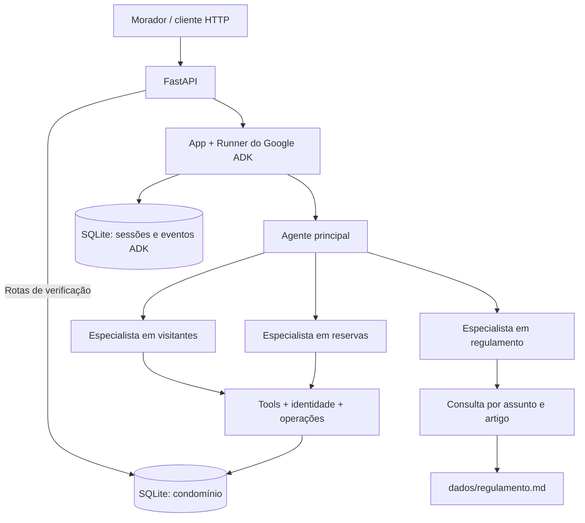

# 🏢 Assistente do Residencial Aurora

Reservas de áreas comuns, autorização de visitantes e consulta ao regulamento por
conversa, com identidade, confirmação e exclusividade de reservas verificadas em código.

**Python 3.12+ · Google ADK 2.2.0 · Gemini · FastAPI · SQLite · uv**

Projeto desenvolvido para o desafio do MBA em Inteligência Artificial da Full Cycle.
O contrato e os critérios de aceite estão no [enunciado](docs/enunciado.md).

[Arquitetura](#arquitetura) · [Garantias](#garantias) · [Como rodar](#como-rodar)

<a id="arquitetura"></a>

## 🧩 Arquitetura

A API recebe a conversa e o Google ADK coordena um agente principal com três
especialistas. As tools consultam e alteram o domínio através de serviços que
validam identidade, decisões de confirmação e restrições do banco.



### Agentes e responsabilidades

Todos os agentes são definidos em [agents.py — build_app](src/aurora/agents.py#L16)
e usam o modelo configurado em `GEMINI_MODEL`.

| Agente | Responsabilidade | Como é acionado |
| --- | --- | --- |
| `principal` | Identificar a intenção e encaminhar o atendimento. | Entrada da conversa e transferências de retorno dos especialistas. |
| `reservas` | Listar áreas, consultar disponibilidade e reservas próprias, reservar e cancelar. | Transferência do principal via `sub_agents`. |
| `visitantes` | Consultar visitantes próprios e solicitar autorizações de entrada. | Transferência do principal via `sub_agents`. |
| `regulamento` | Recuperar artigos pertinentes e responder com referência ao regulamento. | Transferência do principal via `sub_agents`. |

As transferências permitem trocar de assunto na mesma sessão. A divisão por domínio
limita as ferramentas de cada especialista e mantém a consulta ao regulamento
separada das operações de reservas e visitas. O principal não recebe o regulamento
nas instruções nem possui tools de leitura ou escrita do domínio.

### Organização do código e dos dados

| Componente | Papel |
| --- | --- |
| [api.py](src/aurora/api.py) e [schemas.py](src/aurora/schemas.py) | Rotas HTTP, validação dos payloads e códigos de resposta. |
| [runtime.py](src/aurora/runtime.py) | Sessões persistentes, execução do Runner, eventos e retomada de confirmações. |
| [tools](src/aurora/tools/__init__.py) e [identity.py](src/aurora/identity.py) | Argumentos das ações e resolução do apartamento autenticado. |
| [repositories.py](src/aurora/repositories.py) | Decisões de confirmação, execução idempotente e efeitos das operações. |
| [storage.py](src/aurora/storage.py) | Esquema SQLite, transações, consultas e restauração dos dados iniciais. |
| [regulation.py](src/aurora/regulation.py) | Índice lexical do regulamento por capítulo e artigo. |
| [config.py](src/aurora/config.py) e [cli.py](src/aurora/cli.py) | Configuração do ambiente e comandos `serve` e `reset`. |

Os cinco arquivos de [dados/](dados/) são preservados como estado inicial. As mudanças
ficam em `var/condominio.sqlite3`; as sessões e os eventos do ADK, em
`var/sessoes.sqlite3`. O diretório pode ser alterado por `AURORA_DATA_DIR`.
Não há serviço de banco externo nem necessidade de Docker.

<a id="garantias"></a>

## 🛡️ Garantias

### 1. Cobrança ou acesso somente com confirmação

Uma reserva com taxa e qualquer autorização de visitante geram uma pendência em
`confirmacoes_pendentes`. O efeito só é executado após aprovação por
`POST /sessoes/{session_id}/confirmacoes`. Quadra gratuita e cancelamento próprio
dispensam confirmação.

**Onde está implementado:**

- [tools/__init__.py — perform, reservar e autorizar](src/aurora/tools/__init__.py#L24): a taxa vem do cadastro; autorizações sempre exigem confirmação estruturada do ADK.
- [repositories.py — Operations.prepare e correlate](src/aurora/repositories.py#L18): persistem os argumentos e a correlação entre sessão, invocação, especialista e chamada de tool.
- [repositories.py — Operations.decide e execute](src/aurora/repositories.py#L45): aceitam somente uma decisão para uma pendência daquela sessão, validam a aprovação e gravam efeito e resultado na mesma transação.
- [runtime.py — Runtime.resume e confirm](src/aurora/runtime.py#L82): enviam `FunctionResponse` de `adk_request_confirmation` ao Runner com o `invocation_id` original, usando o App resumível definido em [agents.py](src/aurora/agents.py#L50).

**Por que não depende do prompt:** texto de consentimento não altera a decisão
persistida. O serviço também recusa reserva paga ou visitante sem essa decisão.
Negar não cria reserva nem visita; aprovar executa uma única vez. ID inexistente,
de outra sessão ou já respondido retorna `409` antes de qualquer retomada.

### 2. Cada sessão pertence a um apartamento

O apartamento informado na criação da sessão representa o morador autenticado.
Reservas, cancelamentos e visitantes ficam restritos a essa identidade.

**Onde está implementado:**

- [runtime.py — Runtime.create_session](src/aurora/runtime.py#L39): cria o state e o vínculo persistido entre sessão, usuário ADK e apartamento.
- [storage.py — trigger vinculo_imutavel](src/aurora/storage.py#L16): impede atualizar o vínculo já criado.
- [identity.py — apartment_for](src/aurora/identity.py#L7): confere o usuário e o state contra o vínculo persistido antes do acesso aos dados pessoais.
- [storage.py — Storage.reservations e visitors](src/aurora/storage.py#L105) e [repositories.py — Operations._effect](src/aurora/repositories.py#L92): filtram consultas e cancelamentos pelo apartamento da sessão.
- [tools/__init__.py — consultar_disponibilidade](src/aurora/tools/__init__.py#L41): informa disponibilidade sem expor o proprietário ou o código da reserva que ocupa a data.

**Por que não depende do prompt:** nenhuma tool recebe um apartamento escolhido
pelo modelo. Alegar outra identidade na conversa não altera o vínculo usado nas
consultas e nas gravações.

### 3. Conversas e dados sobrevivem ao reinício

Parar e subir a API preserva sessões, eventos, reservas, visitantes e pendências.
O histórico completo continua disponível e a mesma sessão aceita novas mensagens.

**Onde está implementado:**

- [runtime.py — Runtime.__init__](src/aurora/runtime.py#L19): configura `DatabaseSessionService` com SQLite em disco.
- [runtime.py — Runtime.session e events](src/aurora/runtime.py#L48): recuperam a sessão persistida e expõem seus eventos completos, incluindo chamadas e respostas de tools.
- [storage.py — Storage.__init__](src/aurora/storage.py#L31): abre o banco de domínio e só carrega os dados iniciais quando ainda não há apartamentos cadastrados.
- [runtime.py — Runtime.reconcile](src/aurora/runtime.py#L63): na próxima mensagem, tenta concluir decisões já aceitas que ficaram sem resultado após uma interrupção.

**Por que não depende do prompt:** o estado está nos bancos em disco. Reiniciar o
processo não executa o reset; a retomada usa os eventos e os identificadores
persistidos, com resultados idempotentes no serviço de operações.

### 4. O regulamento é consultado por assunto

As respostas usam artigos recuperados de `dados/regulamento.md`. O documento
completo não é inserido nas instruções do principal nem retornado pela tool.

**Onde está implementado:**

- [regulation.py — Regulation.__init__ e search](src/aurora/regulation.py#L31): dividem o documento em capítulos e artigos, selecionam assuntos por termos e sinônimos e retornam os trechos correspondentes. Pedidos de texto integral recebem uma orientação para escolher um assunto.
- [agents.py — consultar_regulamento e build_app](src/aurora/agents.py#L16): disponibilizam essa consulta ao especialista `regulamento`, enquanto o principal recebe apenas instruções de encaminhamento.

**Por que não depende do prompt:** o código determina os trechos retornados pela
busca. O arquivo é indexado localmente; o histórico recebe o resultado seletivo da
tool. Para o horário da piscina aos domingos, a busca retorna o artigo 22.

### 5. Dois moradores, no máximo uma reserva

A exclusividade vale no instante da gravação, inclusive quando duas sessões
aprovam reservas da mesma área e data simultaneamente.

**Onde está implementado:**

- [storage.py — índice reservas_area_data_ativa](src/aurora/storage.py#L19): impõe unicidade de `(area, data)` para reservas ativas.
- [storage.py — Storage.transaction](src/aurora/storage.py#L54): usa `BEGIN IMMEDIATE`, commit/rollback e tentativas limitadas para contenção de lock.
- [repositories.py — Operations._effect](src/aurora/repositories.py#L92): converte a violação desse índice em resultado `indisponivel`, permitindo resposta HTTP normal para a tentativa que perdeu a disputa.

Trecho do índice, com formatação expandida:

```sql
CREATE UNIQUE INDEX IF NOT EXISTS reservas_area_data_ativa
ON reservas(area, data)
WHERE status = 'ativa';
```

**Por que não depende do prompt:** o SQLite rejeita a segunda reserva ativa mesmo
que ambas as conversas tenham consultado a data quando ainda estava livre.
Os códigos também são registrados em `codigos_emitidos` antes da reserva e
permanecem no catálogo após cancelamentos e restaurações.

<a id="como-rodar"></a>

## 🚀 Como rodar

### Pré-requisitos e configuração

Tenha Python **3.12 ou superior**, [uv](https://docs.astral.sh/uv/) e uma chave do
[Google AI Studio](https://aistudio.google.com/apikey) com acesso ao modelo escolhido.
Execute os comandos na raiz do repositório.

```bash
cp .env.example .env
```

Preencha `GOOGLE_API_KEY` no `.env`. As demais variáveis são opcionais:

| Variável | Uso | Padrão quando vazia ou ausente |
| --- | --- | --- |
| `GOOGLE_API_KEY` | Chave usada para as chamadas ao Gemini. | Sem padrão; necessária para conversar com o modelo. |
| `GEMINI_MODEL` | Modelo utilizado pelo principal e pelos especialistas. | `gemini-3.5-flash-lite` |
| `AURORA_DATA_DIR` | Diretório dos bancos de domínio e sessões. | `var/`, relativo ao diretório de execução. |

O `.env` e os bancos são ignorados pelo Git. O modelo padrão está definido em
[config.py](src/aurora/config.py); escolha outro conforme os modelos e limites
disponíveis no seu projeto do AI Studio.

### Instalação e primeira execução

```bash
uv sync --locked
uv run aurora reset
uv run aurora serve
```

### Validação de qualidade

Após `uv sync` (ou `uv sync --locked` em uma instalação reproduzível), execute
os checks nesta ordem antes de entregar alterações. Eles complementam a
validação manual funcional descrita abaixo e não substituem seus cenários:

```bash
uv run ruff format --check src
uv run ruff check src
uv run mypy src/aurora
```

Para aplicar a formatação localmente, use `uv run ruff format src` e repita os
três comandos de validação.

A API escuta em **http://localhost:8000**. A documentação interativa fica em
**http://localhost:8000/docs** e o contrato OpenAPI em
**http://localhost:8000/openapi.json**.

Para continuar uma execução anterior, rode somente `uv run aurora serve`.

**Restauração:** com a API parada, execute `uv run aurora reset`. O comando repõe
reservas e visitantes conforme `dados/`, remove sessões, eventos, pendências e
operações, e preserva o catálogo de códigos já emitidos. Os arquivos de `dados/`
permanecem inalterados.

Se o terminal estiver com um ambiente virtual de outro projeto ativo, desative-o
ou use `env -u VIRTUAL_ENV uv ...` para executar com a `.venv` deste projeto.

### Primeira conversa pela API

Em outro terminal, confira os dados iniciais. Estas consultas não chamam o modelo:

```bash
curl -sS http://localhost:8000/apartamentos/101/reservas
curl -sS http://localhost:8000/apartamentos/302/visitantes
```

Após o reset, as respostas incluem `RSV-1377` para o apartamento 101 e
`Marina Duarte`, em `2030-03-16`, para o apartamento 302.

Crie uma sessão; a resposta será `201` com o campo `session_id`:

```bash
curl -sS http://localhost:8000/sessoes \
  -H 'Content-Type: application/json' \
  -d '{"apartamento":"101"}'
```

Copie o identificador retornado e peça uma reserva:

```bash
SESSION_ID='cole-o-session_id-retornado'

curl -sS "http://localhost:8000/sessoes/$SESSION_ID/mensagens" \
  -H 'Content-Type: application/json' \
  -d '{"texto":"Reserve o salão de festas para 2030-04-20."}'
```

Como o salão tem taxa, a resposta contém uma confirmação pendente. Exemplo de
formato, com identificador ilustrativo:

```json
{
  "resposta": "",
  "confirmacoes_pendentes": [
    {
      "id": "id-da-confirmacao",
      "acao": "reservar",
      "detalhes": {
        "area": "salao-de-festas",
        "data": "2030-04-20",
        "taxa_centavos": 15000
      }
    }
  ]
}
```

Copie o `id` recebido para aprovar pela rota própria:

```bash
CONFIRMATION_ID='cole-o-id-da-confirmacao'

curl -sS "http://localhost:8000/sessoes/$SESSION_ID/confirmacoes" \
  -H 'Content-Type: application/json' \
  -d "{\"id\":\"$CONFIRMATION_ID\",\"confirmado\":true}"

curl -sS http://localhost:8000/apartamentos/101/reservas
curl -sS "http://localhost:8000/sessoes/$SESSION_ID/eventos"
```

Use `false` para negar. A decisão deve ser um booleano JSON; reenviar o mesmo ID
retorna `409`. Enquanto houver pendências, novas mensagens recebem uma orientação
para respondê-las pela rota de confirmações, sem executar outra conversa.

### Rotas e respostas

| Método | Rota | Resultado esperado |
| --- | --- | --- |
| `POST` | `/sessoes` | `201` e `session_id`; corpo com `apartamento`. |
| `POST` | `/sessoes/{session_id}/mensagens` | `200`, `resposta` e `confirmacoes_pendentes`; corpo com `texto`. |
| `POST` | `/sessoes/{session_id}/confirmacoes` | `200` no mesmo formato das mensagens; corpo com `id` e `confirmado`. |
| `GET` | `/sessoes/{session_id}/eventos` | `200` e lista de eventos completos em ordem. |
| `GET` | `/apartamentos/{apartamento}/reservas` | `200` e reservas ativas com `codigo`, `area` e `data`. |
| `GET` | `/apartamentos/{apartamento}/visitantes` | `200` e visitantes com `nome` e `data`. |

Sessão inexistente retorna `404`; confirmação que não está pendente naquela
sessão, `409`; payload inválido, `422`. Falhas do provedor e interrupções de
execução tratadas pela API retornam `503`. Se uma decisão já foi aceita e ficou
sem resultado, a próxima mensagem tenta reconciliá-la.

As rotas de verificação acessam o banco diretamente e existem para o avaliador.
Conforme o escopo do desafio, não há autenticação implementada nem processamento
de pagamento: o apartamento da criação representa a identidade autenticada, e a
taxa determina a necessidade de confirmação.

### Validação e limite de chamadas

O [roteiro de validação manual](docs/validacao-manual.md) cobre os passos do
avaliador. A [prova de compatibilidade ADK](docs/prova-adk.md) registra a topologia
e a retomada de confirmações com sessões SQLite em processos separados.
Para conferir a integridade dos dados iniciais:

```bash
sha256sum -c docs/dados.sha256
```

**Cota do Gemini:** uma mensagem HTTP pode gerar várias chamadas ao modelo por
causa de transferências entre agentes e execução de tools. O runtime limita cada
execução a oito chamadas, mas **não implementa um limitador global por minuto**.
Se o projeto estiver limitado a 15 requisições por minuto, controle a cadência das
chamadas reais ao Gemini durante os testes; conte também as retomadas de confirmação.
As consultas `GET` e a criação de sessões não consomem chamadas ao modelo.
